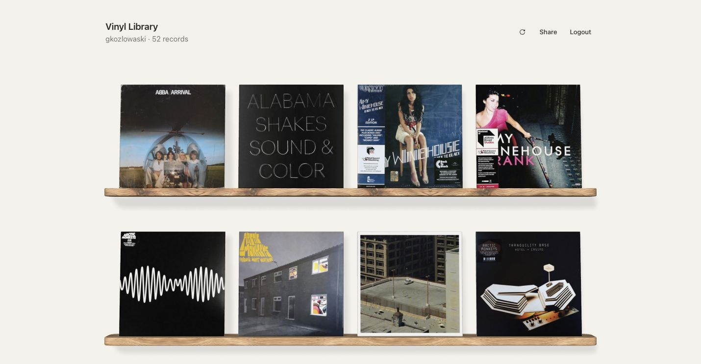
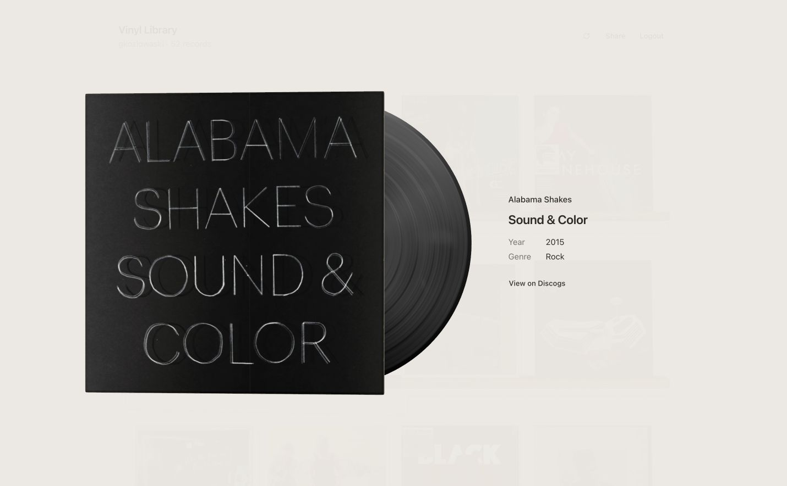

<div align="center">

# Vinyl Library

**Your Discogs collection, on a shelf.**

Browse your records, take a closer look at the artwork, and share your collection with a link.

[Features](#features) · [Get started](#get-started) · [Spotify playback](#spotify-playback-optional) · [Your data](#your-data)

</div>



Vinyl Library turns your Discogs collection into an interactive record shelf. Connect your account and start browsing. The app only reads your collection; your Discogs records stay unchanged.

## Features

- **Browse the artwork.** Wooden 3D shelves adapt to desktop and mobile screens. Vinyl records are arranged by artist, then album title.
- **Pick up a record.** Click or tap a sleeve to see the vinyl slide out and spin. Explore release details or open Discogs. Click the sleeve again or press **Escape** to put it back.
- **Stay up to date.** A saved copy appears on return visits while Discogs updates load. Use the refresh button after adding records.
- **Share your shelf.** Click **Share** to copy a collection snapshot link. Visitors can browse without signing in.
- **Listen as you browse.** Optional Spotify setup adds an album player to matching records.

Keyboard navigation is supported. Browsers without 3D graphics support show a simple record list.

<details>
<summary>Take a closer look at a record</summary>



</details>

## Get started

You’ll need **Node.js 24**, **npm**, and a **Discogs account** with records in its collection.

### 1. Register a Discogs application

Create an application in your [Discogs developer settings](https://www.discogs.com/settings/developers). Set its callback URL to:

```text
http://localhost:3000/auth/discogs/callback
```

Keep its consumer key and consumer secret for the next step.

### 2. Configure the app

From the project directory:

```bash
npm ci
cp .env.example .env
```

In `.env`, fill in `DISCOGS_CONSUMER_KEY` and `DISCOGS_CONSUMER_SECRET`. Generate a key for `TOKEN_ENCRYPTION_KEY` with:

```bash
openssl rand -base64 32
```

Paste the output into that setting. Leave the other defaults as supplied; Spotify settings can stay empty.

### 3. Open your shelf

```bash
npm run dev
```

Open [localhost:3000](http://localhost:3000), choose **Connect Discogs**, and approve access on Discogs. Your vinyl collection imports automatically. Large collections take longer on the first visit.

> [!TIP]
> Using another address? Update `APP_URL`, `DISCOGS_USER_AGENT`, and the Discogs callback URL to match. Use HTTPS when hosting online, and keep `.env` private.

## Spotify playback (optional)

Spotify playback is experimental. Create an app in the [Spotify developer dashboard](https://developer.spotify.com/dashboard), add its `SPOTIFY_CLIENT_ID` and `SPOTIFY_CLIENT_SECRET` to `.env`, and restart the server. `SPOTIFY_MARKET` defaults to `NL`; change it to your two-letter country code if needed.

Opening a record looks for a confident artist-and-title match. The player appears when ready, and matches are remembered in that browser. Closing the record stops playback. Shared shelves don’t include Spotify.

> [!NOTE]
> Spotify access and catalog availability can limit matching. Spotify determines whether you hear full tracks or previews; your browser may require pressing play. No Spotify authorization through Vinyl Library is needed.

## Your data

Your collection and Spotify matches are saved in your browser. Sign-in credentials stay in an encrypted cookie inaccessible to browser JavaScript. No database is needed, and no collection or account credentials are saved in server-side storage.

- **Logout** ends your session and keeps saved browser data.
- **Disconnect and delete data** also removes saved collections and Spotify matches from that browser. Discogs and other devices are unaffected.
- To revoke the app’s access across devices, use your [Discogs application settings](https://www.discogs.com/settings/applications).

> [!IMPORTANT]
> Anyone with a share link can view its username and records. Links contain a fixed snapshot with no sign-in credentials. Create a new link to share updates. Very large collections may exceed the link size limit; the app reports this rather than leaving records out.

## Project commands

Built with TanStack Start, React, TypeScript, and Three.js.

| Command | Purpose |
| --- | --- |
| `npm run dev` | Start the local app at port 3000. |
| `npm run build` | Create a production build. |
| `npm run typecheck` | Check TypeScript types. |
| `npm test` | Run the automated tests. |

## Troubleshooting

- **Can’t connect?** Check your Discogs key, secret, and callback URL. Restart after changing `.env`. For expired or revoked access, choose **Reconnect**.
- **Refresh failed?** If Discogs is limiting requests, wait a minute and retry. Your saved collection remains visible.
- **Empty shelf?** Only Discogs releases marked as vinyl are imported.
